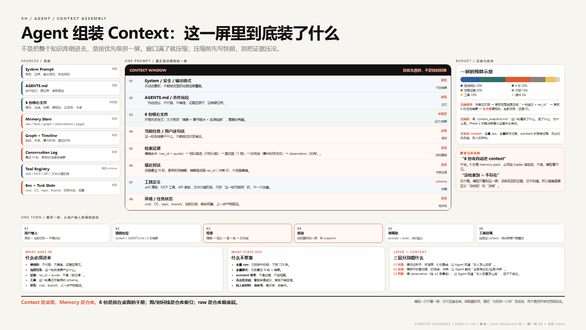
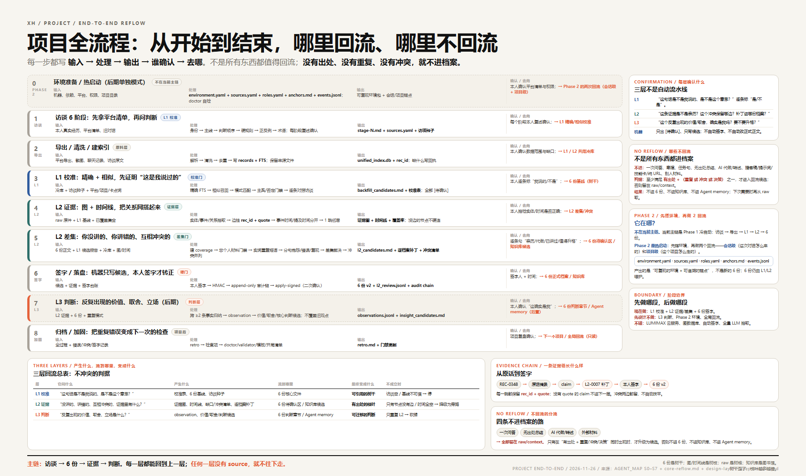

# A94 · 三层回流：校准 → 证据 → 判断

> 版本：v1 ｜ 日期：2026-11-26 ｜ 状态：**设计稿，先评审，不执行**
>
> 这份文件回答五件事：三层到底是什么、每层产出什么/流向哪里、每层怎么确认、LUMIMAX 能不能覆盖、A94 怎么验。它不是一个新架构，是把现有 XH-Dossier 的 L1/L2 讲清楚，再把 L3 和 Phase 2 放到正确位置。

---

## 0. 先给结论

1. **三层不是三套搜索，是三个门：L1 校准、L2 证据、L3 判断。**
2. **L1 的“检索实现”可以并进 L2；L1 的“校准 + 签字”不能砍。** LUMIMAX 能覆盖精确/语义检索，但不能代替本人确认“这是不是我说的”。
3. **L2 不依附 L1 的结论，但必须读 L1 的“覆盖集合”。** 它要回到 raw 做独立差集：哪些没讲、哪些讲错、哪些互相冲突。
4. **L3 只在能产出“重复出现的价值/取舍”时保留。** 如果它只是把 L2 再说一遍，就砍掉；当前先不做，只留接口。
5. **当前只做 L1 + L2 + 6 份签字。** L3、Phase 2 环境、全局回流都后置；不把“以后要做的”混进今天的验收。

---

## 1. 项目定位：不是聊天摘要器

`AGENT_MAP.md` 的原话是：

> 把散落在几十个聊天窗口里的“我说过的话”，收敛成 6 份带证据、可迁移、能被人签字的个人判断档案。

这句话拆成四个“不是”：

| 不是 | 为什么 |
|---|---|
| 不是聊天摘要器 | 摘要只压字数，不解决“这句话是不是我说的、有没有出处、能不能签字”。 |
| 不是自动写人设 | 人设是模型编的；档案必须能回到原话，且本人签字。 |
| 不是知识图谱展示 | 图是证据索引，不是终点；没有 source 的边不进档案。 |
| 不是全自动流水线 | 机器只出 `[待确认]` 候选；签字、取舍、升格都必须本人做。 |

### 6 份核心文件是什么

| 文件 | 管什么 | 典型内容 |
|---|---|---|
| `AGENTS.md` | 合作站位与硬边界 | 先给结论、不代签、不编造、证据回原文 |
| `00-总入口索引.md` | 入口与流程 | 七步闭环、当前阶段、文件地图 |
| `01-身份与当前主线.md` | 我是谁、现在在做什么 | 身份、主线、不可篡改的核心事实 |
| `02-核心判断准则.md` | 我遇事按什么顺序判断 | 道、法、术、器；判断顺序 |
| `03-硬规则与表达黑话.md` | 什么不能碰、怎么说 | 硬规则、黑话、表达偏好 |
| `04-正反例避坑账.md` | 我踩过什么、怎么避免 | 正例、反例、铁律 |

> **口径纠正：** 旧文档里“份数 × 槽位”的乘法说法已废弃。本方案统一说 **6 份核心文件 / 固定槽位**，不再用乘法口径。6 份是树干，不是 6 个篮子；每份内部按固定章节收，不按“第几格”硬切。

### 什么叫“做成”

- 每条结论能回到 **`rec_id` + 原话片段**；
- 每条冲突两边都留，不自动抹平；
- 每条升格都有 **本人签字 + 时间 + 审计记录**；
- 换一个项目，这 6 份还能用，不是只能在这个聊天窗口里复述。

---

## 2. 三层：每层问什么、产出什么、流到哪里

| 层 | 它问的问题 | 主要输入 | 主要产出 | 谁确认 | 流向 | 失败时 |
|---|---|---|---|---|---|---|
| **L1 校准** | “这句话是不是我说的、是不是这个意思？” | 访谈 6 阶段 + 冷库 + 平台/项目/卡点词 | 校准表、6 份基线、访谈种子 | 本人逐条标“是/不是” | 6 份核心文件 | 访谈空 / 基线不可信 → 停 |
| **L2 证据** | “没讲的、讲错的、互相冲突的，证据里有什么？” | 6 份正文 + L1 报告 + 冷库 + 图/时间线 | 证据图、时间线、缺口清单、冲突清单、逐档案补丁 | 本人勾“亲历/代做/已讲过/值得升格” | 6 份待确认区 / 知识库候选 | 只有节点没有边 / 时间全空 → 降级为旁路 |
| **L3 判断** | “反复出现的价值、取舍、立场是什么？” | L2 证据 + 6 份 + 重复模式 | observation、价值/取舍/判断候选 | 本人确认“这确实是我” | 6 份判断章节 / Agent memory | 只重复 L2 → 砍掉 |

### 2.1 L1 校准：先把“我说的”钉死

**输入：**
- 访谈 6 阶段的 `stage-N.md`；
- `sources.yaml`（平台、会话、时间范围）；
- 冷库 `unified_index.db`；
- 从访谈生成的查询词：平台名、项目名、卡点、验收、拖延、术语、人物、事件。

**处理：**
1. 精确匹配：FTS5 / `LIKE` 兜底，优先命中原词；
2. 相似匹配：向量/字符 n-gram，只做召回，不做判决；
3. 模式匹配：`ai_misunderstood_user`、`affirmative_action`、`method_principle`；
4. 门禁：主宾反转、否定句、AI 代做/转述；
5. 逐条对照访谈：这句话是本人原话，还是 AI 总结/材料/别人说的。

**输出：**
- `backfill_candidates.md`：每条 `[待确认]`，带 `REC-xxxx | 日期 | 角色 | 原文`；
- `calibration.jsonl`：`claim_id, rec_id, quote, status(accepted/rejected/needs_info), note`；
- 6 份基线：不是“更多内容”，是最稳定的那部分。

**确认门：**
- 本人逐条标“我说的 / 不是 / 需要再看原文”；
- 不接受“AI 觉得像”就算通过；
- 访谈里没有的，不能凭 raw 反推成人设。

**关键边界：** 精确/相似只是“找到候选”，校准是“判断这句话能不能当基线”。L1 的输出不是“事实清单”，而是“可引用的基线”。

### 2.2 L2 证据：回到 raw 做差集，不是换个关键词再查一遍

**三个输入，缺一不可：**

1. **第一次回流后的 6 份档案正文**（不是模板，不是空文件）；
2. **L1 的候选报告**（知道哪些已经讲过、哪些还在待确认）；
3. **冷库原文**（raw 才是证据，不是 L1 的结论）。

> 只给冷库、不给 6 份，就还是旧的“二次回填原型”，不是第二层。L2 的第一句话必须是：“这条在档案里出现过吗？”回答不了，就不是 L2。

**七步：**

1. **建 coverage**：从 6 份正文抽 `covered_rec_ids` + 每章节实词集合；
2. **读 L1 报告**：把 `[待确认]` 标成 `cross_ref=L1`，不重复产出；
3. **读冷库**：逐条 `rec_id`、`source_file`、`created_at`、`role`、`content`；
4. **非个人材料门禁**：剔除提示词、播客稿、智能总结、技能卡、纯 URL、超长粘贴、无第一人称经历；
5. **实词化重复短语**：去停用词、跨 ≥2 个 `source_file`、长度 4–12、不跨标点；
6. **分句级信号**：抱怨、反复错误、复现主题；否定句、主宾反转拦截；
7. **差集裁决**：`covered_by_profile` / `in_l1_pending` / `claimed_by_real_pattern` 都不成立，才是 L2 候选；冲突两边并列。

**输出：**
- `l2_candidates.md`：每条 `[待确认]`、`L2-NNNN`、`REC-id | created_at`、信号类型、证据字段、建议档案与章节；
- `l2_profile_patches/<档案名>.patch.md`：只写“待确认区”，不碰正式正文；
- `l2_review.jsonl`：`{candidate_id, rec_id, layer:2, status, reviewer, reviewed_at, signed_at, note}`；
- 冲突清单：两边原话 + 各自 `rec_id`，不选边。

**确认门：**
- 本人逐条勾：`□ 本人亲历`、`□ AI 代做/转述/材料`、`□ 已讲过`、`□ 值得升格`；
- “AI 代做/转述”被勾选即 `rejected`；
- 签字后才 `signed`，`apply-signed` 还要二次确认；
- 没有签字记录的条目，永远显示 `[待确认]`。

**L2 和 L1 的关系：**
- L2 **读 L1 的覆盖集合**，所以“不太依附”不等于“完全独立”；
- L2 **必须回 raw 做独立差集**，所以它不是 L1 的复读机；
- 这正是用户说的：“第二层证实第一层，把没讲到的补全，把做过的事分类，把冲突列出来让我们确认。”

### 2.3 L3 判断：跨事实归纳，不是把 L2 再说一遍

**输入：**
- L2 的证据图 + 时间线 + 冲突清单；
- 6 份正文；
- 重复出现的模式：同一价值/取舍/立场，跨 ≥2 条事实、跨 ≥2 个时间点。

**处理：**
1. 找“重复出现”的价值/代价/取舍，不是找“高频词”；
2. 每条 observation 挂 **≥2 条事实**（`rec_id` + quote）；
3. 保留支持证据、反例、变化历史；
4. 不覆盖旧观点：新旧并列，标“当时/现在”；
5. 只出候选，不定稿。

**输出：**
- `observations.jsonl`：`{obs_id, statement, support_rec_ids, counter_rec_ids, first_seen, last_seen, confidence, status}`；
- `insight_candidates.md`：价值/取舍/核心判断候选，每条能回到 L2。

**确认门：**
- 本人确认“这确实是我”，不是“AI 觉得像我”；
- 没有 ≥2 条事实支撑的，不叫 observation，只是猜测；
- 旧观点不删，只标“已变化/仍成立/冲突”。

**当前状态：后置。** 现在只做 L1 + L2；L3 只留接口和字段，不进入本次验收。原因很简单：L1/L2 没稳，L3 一定会把错误放大。

---

## 3. 三层为什么不冲突

### 3.1 三个问题不同，产出不同，失败模式不同

| 判据 | L1 | L2 | L3 |
|---|---|---|---|
| 问题 | 是不是我说的 | 没讲/讲错/冲突 | 反复出现的价值 |
| 产物 | 校准表 + 基线 | 证据图 + 缺口/冲突 + 补丁 | observation + 判断候选 |
| 证据单位 | 访谈原话 / raw 原话 | `rec_id` + quote + 边/时间 | ≥2 条事实 + 反例/变化 |
| 失败模式 | 把 AI 总结当本人 | 把“没召回”当“没讲过” | 把 L2 复述当洞察 |
| 确认人 | 本人 | 本人 | 本人 |

### 3.2 重叠时怎么处理

- **L1 开始输出“事实清单”** → 收回。L1 只做校准，事实清单是 L2 的活。
- **L2 开始写“人生结论”** → 收回。L2 只做证据、缺口、冲突，结论是 L3 的活。
- **L3 只是把 L2 再说一遍** → 砍掉。L3 必须产出“重复出现的价值/取舍/下一步”，否则没有独立存在必要。
- **L2 想完全独立重跑 raw** → 可以，但会重复 L1 的召回；建议读 L1 的 covered set，再做差集。独立的是“判断”，不是“把同样的搜索再跑一遍”。

### 3.3 直接回答两个质疑

**“LUMIMAX 能不能把第一步精确检索和第二步语义检索都覆盖？”**

- **检索层：能。** LUMIMAX 的 BM25 关键词 + 向量 + 实体/事件多路召回，确实能覆盖精确和语义。**L1 的检索实现可以并进 L2，不用单独养一套搜索。**
- **校准层：不能。** LUMIMAX 没有“本人逐条确认这是不是我说的”这个门；它编译完直接用。**L1 的校准 + 签字不能砍。**
- **结论：** 砍 L1 的“检索代码”，保留 L1 的“校准 + 签字”。三层变成“两个引擎 + 一个判断门”，不是三套重复搜索。

**“第二层深度证据能不能覆盖第一层？能覆盖就砍掉。”**

- 能覆盖 **检索**，不能覆盖 **校准**。
- 如果 L1 只剩“跑一遍搜索”，那它确实该并进 L2；
- 如果 L1 是“访谈 → 逐条确认 → 6 份基线”，它就不能砍，因为 L2 的所有差集都要以这 6 份为“已覆盖集合”。
- **建议：L1 保留为“校准门”，检索实现并进 L2。** 这样既不重复，也不丢签字。

**“第三层和各层冲突/相似/连在一起，是不是没有存在必要？”**

- 如果 L3 只是“更多事实/更多图”，没有存在必要；
- 如果 L3 能产出“跨 ≥2 条事实、反复出现的价值/取舍/立场”，它有独立价值；
- **当前先不做 L3**，等 L1/L2 稳了再判断。这样不会为了“三层好看”硬造一层。

---

## 4. LUMIMAX 流程映射：不照搬它的节点分类

先看它的 6 段流程，不看它画了多少种节点：

| LUMIMAX 阶段 | 它做什么 | 我们怎么用 | 落在哪层 |
|---|---|---|---|
| 原始资料 | PDF/Word/Excel/PPT/网页/API | raw、访谈原文、导出记录 | L1/L2 输入 |
| 深度解析 | 版面、章节、表格、公式、图片 | 清洗、切分、编码、会话还原 | 预处理 |
| 知识抽取 | 实体、事件、文档摘要、条款、术语 | 实体、事件、claim、时间字段 | L2 证据 |
| 关系构建 | 实体/事件/金额/条款/来源建边 | 边 + `rec_id` + quote；不建空边 | L2 证据 |
| 跨文档推理 | 实体消歧、事件归并、跨源对齐 | 跨对话实体消歧、事件归并 | L2 证据 |
| 证据核验 | 段级 grounding、冲突独立成区 | 冲突两边并列、每条回原文 | L2 确认 |
| 检索/问答 | BM25 + 向量 + 实体/事件 + 多跳 | 四路召回、1 跳邻居 | L2 检索 |

### 借什么 / 不借什么

**借：**
- 段级 grounding：每条结论回文件/段；
- 实体消歧、事件归并、冲突页签；
- BM25 + 向量 + 实体/事件混合召回；
- 双时间字段：事件时间 ≠ 提及时间。

**不借：**
- 14 类法律实体、全量重预编译；
- 无人工签字、自动出图即定稿；
- 关系网 UI、社区检测、云服务；
- 为了“像 LUMIMAX”而硬造节点类型。

### 现有真实差距（不粉饰）

- 真实库 729 条，`event_date` 663 条为空，时间轴覆盖率约 9%；
- L2 主脚本在真库跑出 0 条候选，6 条来自后补的 `05b_l2_theme.py`；
- 当前图样例 3 实体 / 1 边；1 条 temporal 命中，0 条 graph 命中；
- 所以现在不是“LUMIMAX 级 DEN”，只是“有图/时间旁路”。这一轮先把流程跑对，不先吹能力。

### 图检索下一步

1. 先按 LUMIMAX 的 6 段流程，把 raw → 解析 → 抽取 → 关系 → 核验 → 检索跑一遍；
2. 只记录“实际抽出了什么”，不先定 10 类节点/13 类边；
3. 等本人看过真实抽取结果，再决定节点类型和边类型；
4. 没有 `rec_id` + quote 的边，一律不建。

---

## 5. Hindsight 三个词，用人话解释

### observation 是什么

不是原始事实，也不是聊天摘要。它是**跨多条事实归纳出来的一句“现在怎么看”**。

例子：
- 事实 1：2026-09 说“先定验收标准再开工”；
- 事实 2：2026-10 说“没定验收就返工了”；
- 事实 3：2026-11 说“以后先写验收单”；
- observation：**“他反复用‘先定验收’来控制返工；没有验收标准时，项目会拖。”**

observation 必须挂：
- 支持它的 `rec_id` + quote；
- 反例（如果有）；
- 首次/最近出现时间；
- 变化历史（当时怎么看，现在怎么看）。

### 判断候选是什么

机器出的 `[待确认]`，不是定稿。
- 它可以写“建议升格为 02-核心判断准则”；
- 但不能自己写进正式档案；
- 本人勾“这确实是我” + 签字，才转正。

### 分库 / 分权 / 分签字是什么

- **分库**：事实库（raw、`rec_id`、quote、图/时间）和判断库（observation、价值/取舍）分开存；判断不能改事实。
- **分权**：机器只有“写候选”的权限，没有“写正式档案”的权限；正式档案只有本人签字后才能改。
- **分签字**：每条候选单独签字，不是“一键全部通过”；签字记录带时间、人、HMAC、append-only 审计链。

一句话：**事实归事实，判断归判断；机器只能提案，本人才能拍板。**

### 借什么 / 不借什么

**借：**
- 双时间字段；
- 叙事式整段抽取；
- observation 的证据条数/趋势/历史；
- 不覆盖旧结论。

**不借：**
- 自动归并直接定稿；
- opinion 置信度当真相；
- 全套 Postgres/pgvector；
- 没有人工确认的“记忆更新”。

---

## 6. Agent 组成与 Context 组装

### 6.1 静态：LLM 六道工序 + Harness 六零件

| 层 | 有什么 | 物理上是什么 |
|---|---|---|
| LLM | 分词 → 预训练 → SFT → 偏好对齐 → 量化打包 → 推理服务 | tokenizer、权重、GPU/HBM、KV cache、context window、tokens/s |
| Harness | context、memory、tools、skill、MCP、文件/沙箱、校验/重试/终止/轨迹 | 模型外面那一圈；决定“能不能收住” |

关键结论：**模型决定下限，Harness 决定上限。** 同一个 3B 模型，不给工具会把天气编成 10℃/-2℃/降雨 0%；给工具 + 环，真实 16.7℃/85%，两帧 10.2 秒。

### 6.2 动态：一帧里 Context 到底装什么

八层，按优先级拼：

1. **System / 安全 / 输出格式**：永远最前，不能被检索结果覆盖；
2. **`AGENTS.md` / 合作站位**：先给结论、不代签、不编造、证据回原文；
3. **6 份核心文件**：开局全文；太大就“摘要 + 章节锚点 + 来源链接”；
4. **当前任务 / 用户这句话**：这一轮到底要干什么；
5. **检索证据**：精确命中（`rec_id` + quote）→ 相似候选（只标分数）→ 图邻居（1 跳）→ 时间线（事件时间优先）→ observation（如有）；
6. **最近对话**：最近 N 轮；更早的摘要，保留 `rec_id`/决策 ID，不保留寒暄；
7. **工具定义**：skill 清单、MCP 工具、API 参数、文件沙箱权限；只放这一轮可能用的；
8. **环境 / 任务状态**：cwd、OS、repo、branch、当前阶段、剩余预算、上一步产物路径。

**预算与压缩：**
- 固定规则约 20%，6 份约 25%，检索证据约 25%，对话约 15%，工具约 10%，缓冲 5%（示意比例，不是实测）；
- 压缩顺序：先裁旧对话 → 再把检索结果压成“一句结论 + `rec_id`” → 再把 6 份压成摘要 → **永不裁**硬规则、当前任务、证据 ID；
- 压缩前写 `context_snapshot.md`：这一轮看到了什么、丢了什么、为什么丢。Phase 2 的锚点从这里长出来。

**两个常见误解：**
- “6 份会自动进 context” → 不会。6 份是 memory pack，必须由 loader 读进来；不读，模型看不见。
- “没检索到 = 不存在” → 不是。模型只看到这一屏；没被召回的证据，它不知道。答案要区分“没找到”和“没有”。

### 6.3 LLM 六道工序，物理上到底怎么做

**① 分词：先定词表，不是先收集海量资料。**
- BPE 用一批代表性语料统计子词频率，产出 `tokenizer.model`；
- 语料来源：Common Crawl、Wikipedia、代码、书籍、对话；清洗、去重、去版权风险；
- 分词训练用的量远小于预训练；预训练才吃 TB 级文本。

**② 预训练：海量文本“猜下一个 token”。**
- 输入 token → Transformer → 预测下一个 token → 交叉熵 → 反传 → 更新权重；
- 物理上：GPU/TPU、HBM、数据管道、checkpoint；这是最贵的一段。

**③ SFT：指令 → 好答案，成对继续训。**
- 数据：几万到几十万条“指令/回答”对，人工 + 合成 + 筛选；
- 物理上：继续梯度更新，让 base model 学会“听指令”，不是只会续写。

**④ 偏好对齐：把回答往人想要的方向推。**
- RLHF：奖励模型 + 强化学习；DPO：直接用偏好对优化；
- 数据：同一问题的好/坏回答对；物理上再训一轮，目标是“更有用、更少胡说”。

**⑤ 量化打包：权重压成低比特，装进 GGUF。**
- FP16/BF16 → INT8/INT4；校准集估缩放；
- 物理上：体积变小、显存变少、速度变快，精度掉一点；本机 `qwen2.5vl:3b` 是 Q4_K_M，3.2GB，128K 上下文，79–94 tok/s。

**⑥ 推理服务：载权重、KV cache、逐 token 生成。**
- prefill：把 prompt 一次算完；decode：一个 token 一个 token 出；
- 物理上：GPU/CPU、显存、KV cache、context window、tokens/s；工具结果塞回上下文，第二帧 prompt 会变长（真实 trace：290 → 519）。

> 这一节只讲“物理上在算什么”，不讲训练配方。我们要的是知道“哪一步能自己跑、哪一步只能调 API”，不是假装能从头训大模型。

---

## 7. 项目全流程：从开始到结束

九步，每一步写清输入、处理、输出、确认、去向：

| 步 | 阶段 | 输入 | 处理 | 输出 | 谁确认 | 去向 |
|---|---|---|---|---|---|---|
| 0 | 环境准备（Phase 2，后期） | 机器、依赖、平台、权限 | `environment.yaml`、`sources.yaml`、`roles.yaml`、`anchors.md`、`events.jsonl`；doctor | 可复现环境包 + 锚点 | 本人确认平台/权限 | Phase 2 的会话级 + 项目级回流 |
| 1 | 访谈 6 阶段 | 真实经历、平台清单、旧对话 | 身份→主线→判断→硬规则→正反例→术语；每阶段复述 | `stage-N.md` + `sources.yaml` + 种子 | 每阶段本人复述 | L1 校准 |
| 2 | 导出/清洗 | 平台导出、截图、聊天记录 | 解析→清洗→去重→`records`+FTS | `unified_index.db` + `rec_id` | 本人确认范围/缺口 | L1/L2 冷库 |
| 3 | L1 校准 | 冷库 + 访谈种子 | 精确→相似→模式→门禁→逐条对照 | `backfill_candidates.md` + 校准表 | 本人逐条“是/不是” | 6 份基线 |
| 4 | L2 证据 | raw + L1 基线 | 实体/事件/关系→边挂 quote→时间索引→1 跳 | 证据图 + 时间线 + 覆盖率 | 本人抽检实体/时间 | L2 差集 |
| 5 | L2 差集 | 6 份正文 + L1 报告 + 冷库 + 图/时间 | coverage→门禁→重复短语→分句→差集→冲突 | `l2_candidates.md` + 补丁 + 冲突 | 本人逐条勾选 | 6 份待确认区 / 知识库候选 |
| 6 | 签字/落盘 | 候选 + 证据 + 台账 | 签字→HMAC→审计链→apply-signed | 6 份 v2 + `l2_review.jsonl` | 本人签字 + 二次确认 | 6 份正式档案 / 知识库 |
| 7 | L3 判断（后期） | L2 证据 + 6 份 + 重复模式 | 跨 ≥2 条事实归纳→observation→判断候选 | `observations.jsonl` + insight | 本人确认“这确实是我” | 6 份判断章节 / Agent memory |
| 8 | 归档/加固 | 全过程 + 错误/冲突/签字 | retro→检查项→doctor/validator/模板 | `retro.md` + 门禁 | 项目复盘确认 | 下一个项目 / 全局回流（只读） |

### 有没有“不回流”的情况？有，而且必须明确

**不进档案的六类：**
1. 一次问答、寒暄、任务句；
2. 无出处的总结；
3. AI 代做/转述/材料；
4. 播客稿、提示词、技能卡、纯 URL；
5. 别人的材料；
6. 没有重复、没有冲突、没有决策的一次性细节。

**判据：** 至少满足 **有出处 +（重复 或 冲突 或 决策）** 之一，才进入回流候选；否则留在 raw/context。

**结果：** 不进 6 份、不进知识库、不进 Agent memory；下次需要时再从 raw 取。这样不会把“聊天噪音”灌进档案。

### Phase 2 在哪

用户说的“第二阶段：先搭建环境，再进行 2 回流”，**不在当前主链**。

- **当前主链（Phase 1 冷启动）：** 访谈 → 导出 → L1 → L2 → 6 份。
- **Phase 2（热启动，后期单独模式）：** 先搭环境（`environment.yaml`、`sources.yaml`、`roles.yaml`、`anchors.md`、`events.jsonl`），再做两个回流：
  - **会话级**：这次对话怎么来的、上下文怎么组装、压缩前快照；
  - **项目级**：这个项目怎么走的、环境事实/决策/错误/证据怎么留。
- **产出：** 可复现的环境 + 可追溯的锚点，不是新的 6 份；6 份仍由 L1/L2 维护。

---

## 8. A94 执行包

### 8.1 A94 是什么

**A94 不是一个新 Agent 角色，是一个独立执行包：**

- **1 个实现**：按任务矩阵写代码/文档；
- **1 个独立 Review**：只看 diff、测试、证据门禁，不做自我审查；
- **1 个验收**：用真实样本跑，签字确认；
- 矩阵不铺大：先 1 条主链，不做 7 个并行 Agent。

### 8.2 任务矩阵

| 任务 | 做什么 | 交付物 | 依赖 |
|---|---|---|---|
| **A94-T0** | 设计评审：三层边界、LUMIMAX 映射、Context 规范 | 本文件 + 3 张图 | 无 |
| **A94-T1** | L1 校准包：访谈种子 → 精确/相似 → 校准表 | `calibration.md`、`calibration.jsonl`、`seeds.yaml` | T0 |
| **A94-T2** | L2 差集包：6 份 + L1 报告 + raw → 缺口/冲突/补丁 | `l2_candidates.md`、patches、`l2_review.jsonl` | T1 |
| **A94-T3** | L2 证据图/时间线：实体/事件/边 + 双时间 | `graph.jsonl`、`timeline.jsonl`、覆盖率报告 | T2 |
| **A94-T4** | 签字/去向：HMAC、审计链、6 份 vs 知识库候选 | `apply_signed` 测试、审计样例 | T2 |
| **A94-T5** | Context loader 规范：manifest + 预算 + snapshot | `context_manifest.json`、loader 设计 | T0 |
| **A94-T6** | 真实验收：5 段旧对话 + 2 次新访谈 | 验收报告 + `pytest` 全绿 | T1–T5 |

### 8.3 非目标

- 不接 LUMIMAX / Hindsight / Mem0 / Supermemory / Zep 的云服务；
- 不引入 Postgres/pgvector/Neo4j；
- 不做全量 LLM 抽取；
- 不自动写 6 份、不自动签字、不自动删除旧观点；
- 不做关系网 UI、社区检测、全量重预编译；
- 不把 Phase 2 环境塞进当前回流；
- 不为了“三层好看”硬造 L3。

### 8.4 验收 / Code Review 清单

**功能：**
- [ ] L1 每条 claim 有 `rec_id` + quote；没有 quote 的不进 6 份；
- [ ] L2 每条候选有 `rec_id` + quote + 信号类型 + 建议章节；
- [ ] L2 冲突两边都留，不自动选边；
- [ ] 非个人材料门禁能挡住提示词/播客稿/技能卡/纯 URL/超长粘贴；
- [ ] 否定句、主宾反转不误判；
- [ ] `apply-signed` 拒绝未签字、拒绝手改 ledger；
- [ ] 6 份 vs 知识库候选分流明确，不放不进的就丢。

**工程：**
- [ ] `pytest -q` 全绿；
- [ ] 旧 demo 不传新参数仍 `DEMO_OK`；
- [ ] 没有新增外部依赖（除非单独批准）；
- [ ] `event_time` / `mention_time` 分开，不混用；
- [ ] 没有 PII 进 git；
- [ ] `context_snapshot.md` 在压缩前生成。

**Review：**
- [ ] Review 只看 diff、测试、证据门禁，不做自我审查；
- [ ] 发现“结论没有 source”直接打回；
- [ ] 发现“自动签字/自动改正式正文”直接打回；
- [ ] 发现“为了通过而改验收”直接打回。

### 8.5 真实验收样本

- **5 段旧对话**：至少覆盖 1 段“AI 误解我”、1 段“验收/拖延”、1 段“方法原则”、1 段“冲突”、1 段“非个人材料”；
- **2 次新访谈**：一次完整 6 阶段，一次中途停掉，验证“缺信息重问”；
- 验收输出：每条候选能点回原话；冲突能两边并列；签字后台账能验签；6 份能生成 v2。

---

## 9. GitHub 议题

详细构想已推到 GitHub：

- **父 issue：** [#124](https://github.com/Dragon-01-you/xh-dossier/issues/124) `[A94] 三层回流重构：校准 → 证据 → 判断（设计先行，不写代码）`
  - 正文：本文件摘要 + 3 张图 + 任务矩阵 + 验收清单；
  - 标签：`enhancement`、`documentation`；
  - 状态：等独立 Agent 评估。
- **子 issue：**
  1. [#125](https://github.com/Dragon-01-you/xh-dossier/issues/125) `[A94-T1] L1 校准包：访谈种子 + 6 份基线 + 校准表`
  2. [#126](https://github.com/Dragon-01-you/xh-dossier/issues/126) `[A94-T2] L2 差集包：6 份 + L1 + raw → 缺口/冲突/补丁`
  3. [#127](https://github.com/Dragon-01-you/xh-dossier/issues/127) `[A94-T3] L2 证据图/时间线：实体/事件/边 + 双时间`
- **PR：** [#123](https://github.com/Dragon-01-you/xh-dossier/pull/123) `design/a94-reflow-v1` → `main`，只放文档和 3 张图，不改代码；等评审后再开实现 PR。

**给其他 Agent 的 6 个评审问题：**
1. L1 的“校准”有没有可测的验收？还是只是感觉？
2. L2 的差集是否真的读了 6 份 + L1 + raw 三路？缺一路会不会退化成旧原型？
3. 图/时间线是证据，还是装饰？没有 `rec_id` + quote 的边怎么处理？
4. L3 和 L2 的边界是否可区分？如果 L3 只复述 L2，是否应该砍？
5. Context loader 的预算是否有确定性？压缩后还能不能回到证据？
6. Phase 2 的“先环境、再 2 回流”是否独立于当前主链？会不会把两套流程混在一起？

---

## 10. 还没定 / 需要拍板

1. **旧文档里的“份数 × 槽位”口径**：是否全仓替换为“6 份核心文件 / 固定槽位”？建议替换，避免再次误导。
2. **L2 是否完全独立重跑 raw**：建议读 L1 的 covered set，再做差集；独立的是判断，不是重复搜索。
3. **L3 现在做不做**：建议后置，只留字段和接口；L1/L2 稳了再开。
4. **A94 载体**：建议 GitHub 父 issue + 3 个子 issue + 1 个 design PR；不直接改代码。
5. **Phase 2 是否单独模式**：建议是；环境准备不塞进当前回流，避免“环境没搭好”拖死 6 份。
6. **图检索节点类型**：先按 LUMIMAX 6 段流程跑真实抽取，再定节点/边；不先拍 10 类节点。

---

## 附：三张图

- `assets/16-lumimax-map.png`：LUMIMAX 6 段流程 → 三层；能覆盖检索，不能覆盖校准。
- `assets/17-context-assembly.png`：Context 八层、预算、压缩、真实一帧。
- `assets/18-end-to-end.png`：九步全流程、每步输入/输出/确认/去向、不回流分支、Phase 2 位置。
