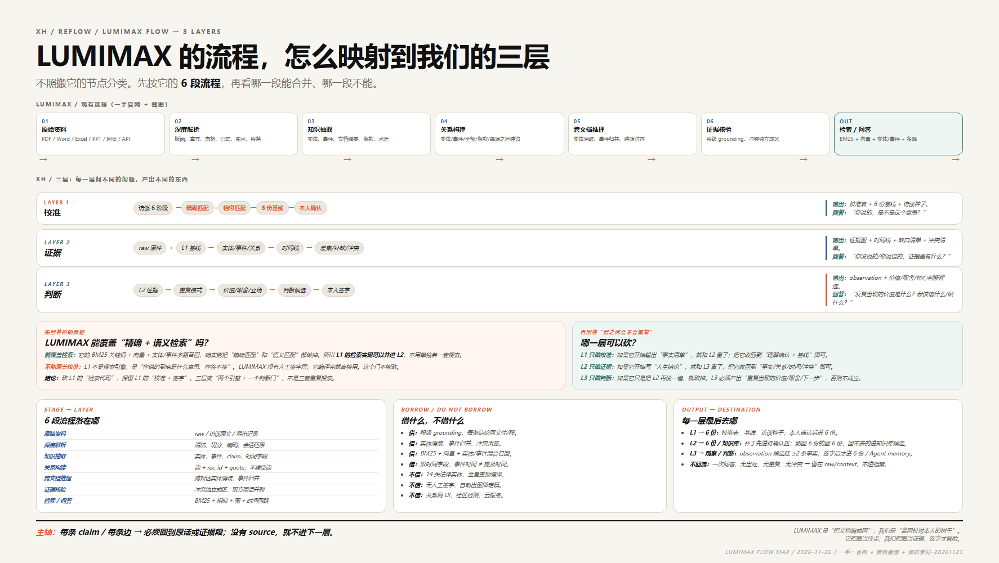
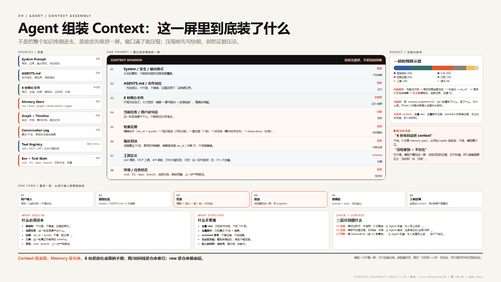
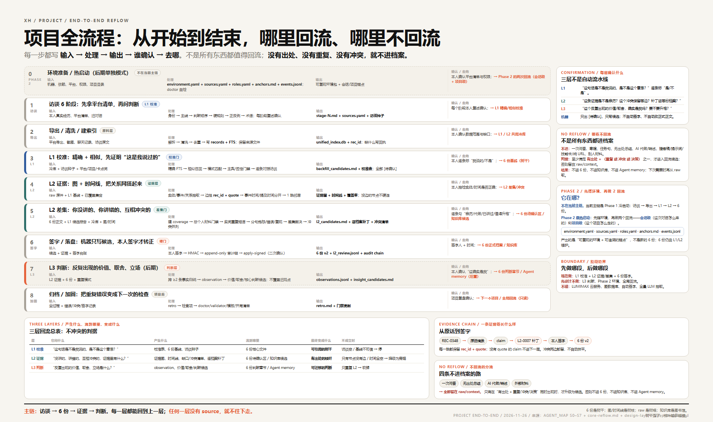

# A94 三层回流：校准 → 证据 → 判断

设计稿，先评审，不执行。完整正文见 [`A94-三层回流-执行包-v1-20261126.md`](./A94-三层回流-执行包-v1-20261126.md)。

## 三张图

1. **LUMIMAX 6 段流程 → 三层**：能覆盖精确/语义检索，不能覆盖本人校准/签字。  
   
2. **Agent Context 组装**：System / AGENTS.md / 6 份 / 当前任务 / 检索证据 / 最近对话 / 工具定义 / 环境状态。  
   
3. **项目全流程**：访谈 → 导出 → L1 → L2 → 签字 → L3（后期）→ 归档；含不回流分支与 Phase 2 位置。  
   

## 一句话结论

- **L1 校准**：证明“这是我说过的”；检索实现可以并进 L2，校准/签字不能砍。
- **L2 证据**：回到 raw 做差集；补没讲的、标讲错的、列冲突；只出 `[待确认]`。
- **L3 判断**：只做“重复出现的价值/取舍”；只复述 L2 就砍；当前后置。
- **当前只做 L1 + L2 + 6 份签字**；L3、Phase 2 环境、全局回流都后置。

## 边界

- 不接 LUMIMAX/Hindsight 云服务，不引 Postgres/Neo4j；
- 不做全量 LLM 抽取，不自动签字，不自动改正式档案；
- 图/时间线是证据索引，不是终点；
- 没有 `rec_id` + quote 的结论，不进下一层。
